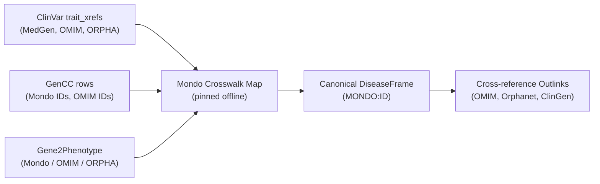

# Gene–Disease & Biological Context — External Scientific & UI/UX Audit

Independent external review of `doc/GENE_DISEASE_PROPOSAL.md` and `doc/EXPRESSION_AND_MODELS_PROPOSAL.md` (Rev 2.1).
Audited on **2026-10-06** against reference tabs (`ClinicalTab`, `PredictorsTab`), rails (`PopulationRail`, `PredictorsRail`), design tokens, and repository contracts.

---

## Executive Summary & Audit Stance

The two companion proposals establish a transformative upgrade to the platform by shifting Missense & Fold from a static, gene-agnostic in-silico predictor into a **phenotype-conditioned and disease-anchored clinical decision support system**.

Crucially, both proposals adhere to the repository’s core doctrine:
1. **True → Traceable → Legible → Beautiful**: No fabricated composite scores, no averaging of divergent curation levels, no silent voting.
2. **Absence is a state, not a value**: Missing data is never coerced to `0`, "Benign", or "Offline".
3. **Rigorous separation of descriptive context from ACMG/ClinGen criteria**: Neither expression breadth nor model-organism perturbation may vote in `criteria.ts`.

However, the audit identified **critical scientific pitfalls**, **legal/licensing hazards**, **ontology crosswalk traps**, and **UI architecture requirements** that must be resolved prior to implementation.

---

## 1. Scientific Validity Audit

### 1.1 Conflicts: Curation Discrepancy & Mechanism Discordance

#### A. Validity Disagreements (GenCC vs ClinGen GCEP vs Gene2Phenotype)
- **The Pitfall**: ClinGen Gene-Disease Validity curations adhere to the ClinGen Gene Curation Working Group framework (Strande et al. 2017, PMID: 28552620), performed by disease-specific Gene Curation Expert Panels (GCEPs). GenCC (DiStefano et al. 2022, PMID: 35612544) aggregates 12 international submitters (ClinGen, PanelApp UK/Aus, TGp, Ambry, Illumina, G2P, Orphanet, etc.). Submitters regularly diverge: e.g., a commercial diagnostic panel or legacy entry in GenCC may list a gene–disease relationship as "Definitive" or "Strong", while a formal ClinGen GCEP re-evaluation designates it as "Limited", "Disputed", or "Refuted" due to modern cohort rigor.
- **Audit Rule**:
  - **No consensus averaging**: Disagreement among curators is primary clinical evidence. Never collapse levels into an average or point estimate.
  - **ClinGen Expert Panel primacy**: Where a ClinGen GCEP curation exists, it must be badged as `ClinGen GCEP (Expert Panel)` beside the broader `GenCC Community` summary.
  - **Dominance of Disputed/Refuted**: If *any* authoritative source (ClinGen or consensus GenCC) classifies an association as `Disputed` or `Refuted`, this finding must visually dominate Tier 1 (Hero) and **explicitly suppress supportive downstream variant-level interpretations** (e.g., displaying a warning: *"Gene-disease association is disputed/refuted by [Source]; computational and structural predictions cannot establish pathogenicity for this phenotype"*).

#### B. Mechanism Conflicts (ClinGen Dosage Sensitivity vs G2P vs In-Silico Predictors)
- **The Pitfall**: ClinGen Dosage Sensitivity (Riggs et al. 2020, PMID: 31690835) curates haploinsufficiency (HI) and triplosensitivity (TS) on a 0–3 scale at the gene level. Gene2Phenotype (Thormann et al. 2019, PMID: 31097695) curates disease-specific molecular mechanisms (Loss of Function, Gain of Function, Dominant Negative). In many genes, one phenotype is caused by haploinsufficiency (LoF), while another is caused by a dominant-negative or activating gain-of-function missense (*FGFR3*, *STAT3*, *RET*, *NOTCH1*). Furthermore, in-silico mechanism classifiers (e.g. PMC11341024) are statistical predictions, not biological measurements.
- **Audit Rule**:
  - Mechanism must be bound to the **Disease–Inheritance tuple**, never to the bare Gene.
  - ClinGen Dosage sensitivity (which reports gene-level dosage tolerance) must be displayed side-by-side with G2P mechanism, with conflicting interpretations explicitly stated (e.g., *"ClinGen HI score: 3 (Sufficient evidence for haploinsufficiency) | G2P Mechanism: Gain of Function for [Disease]"*).
  - Machine-learning mechanism predictors (PMC11341024) must be strictly relegated to secondary context with a mandatory `Predictor` caveat badge, never labelled as curated mechanism.

---

### 1.2 Source Licensing & Redistribution Governance

| Source | License / Terms | Redistribution Status | Permitted Usage in MSE |
|---|---|---|---|
| **GenCC** | CC0 1.0 Universal | Public Domain (attribution requested) | Pinned offline snapshot (JSON/TSV). Live runtime queries prohibited due to IP rate limits (~20/day). |
| **ClinGen** | Open Access / CC-BY equivalent | Public / Unrestricted | Direct API or pinned bulk TSV. Must cite ClinGen release/snapshot date. |
| **Gene2Phenotype (G2P)** | Open Access (EMBL-EBI / Sanger terms) | Public | Pinned snapshots or live lookups with attribution to EBI/Sanger. |
| **OMIM** | **Proprietary Copyright** (Johns Hopkins Univ.) | **STRICTLY NON-REDISTRIBUTABLE** without commercial license. | **Identifiers only (`OMIM:100800`).** NEVER ship OMIM disease titles, descriptions, clinical synopses, or phenotypic series texts in repo or client bundles. |
| **Orphanet** | CC BY 4.0 (Inserm) | Unrestricted with attribution | ORPHA codes and preferred terms permitted with Inserm attribution. |
| **Mondo** | CC BY 4.0 | Unrestricted with attribution | Primary disease ontology key and hierarchy. |
| **Alliance of Genome Resources** | CC BY 4.0 | Unrestricted with attribution | Direct REST queries / cached JSON with DIOPT method attribution. |
| **IMPC** | CC BY 4.0 | Unrestricted with attribution | Solr API queries with DR release tracking. |
| **Bgee** | CC0 1.0 Universal | Public Domain | Offline TSV snapshots of expression calls. |
| **HPO** | Custom Open Access | Attribution + unaltered logic | Use unmodified `genes_to_phenotype.txt` with release timestamp. |

> [!CAUTION]
> **OMIM Copyright Compliance**: ClinVar exports often contain OMIM disease names. To prevent copyright violation, MSE must strictly use OMIM IDs as clickable cross-reference links (`https://omim.org/entry/...`) and rely on **Mondo** or **Orphanet** for disease entity display names.

---

### 1.3 Identity Crosswalks: Resolving Disease Polyhierarchy

The existing codebase (`server/services/external-api/clinvar.ts`) currently extracts only raw text: `trait_name: z.string()`. This is brittle and introduces silent failure modes:
1. ClinVar free-text traits vary widely: `"Achondroplasia"`, `"Achondroplasia, severe"`, `"not provided"`, or vague syndromes.
2. OMIM phenotypic series group distinct genetic subtypes under one numeric umbrella, whereas Mondo organizes disease concepts into a polyhierarchical Directed Acyclic Graph (DAG).
3. Orphanet classifies epidemiological and clinical entities that may have 1-to-many or many-to-1 mappings to OMIM.

#### Proposed Architecture: Mondo as Canonical Key
- The internal identity for `DiseaseFrame.id` must be a **Mondo ID** (`MONDO:0007037`).
- Mondo provides curated crosswalk mappings (`exactMatch`, `closeMatch`, `skos:broadMatch`) to OMIM, Orphanet, MedGen, and NCIT.
- **Server ClinVar Client Fix**:
  `server/services/external-api/clinvar.ts` must parse ClinVar's `trait_set -> trait_xrefs` to extract `MedGen`, `OMIM`, and `Orphanet` IDs.
- **Mapping Pipeline**:
  `ClinVar Condition Xrefs` + `GenCC Mondo IDs` → Join against a pinned `mondo-crosswalk.json` mapping table → Unified list of `DiseaseFrame` candidates.



---

### 1.4 Multiple Inheritance: Conditioning on (Gene, Disease, MOI)

Many key diagnostic genes exhibit **multiple modes of inheritance (MOI)** with drastically distinct mechanisms and variant interpretations:
- *COL4A3*: Autosomal Recessive (Alport syndrome 2, severe nephropathy) vs Autosomal Dominant (Thin basement membrane nephropathy / Alport syndrome 3).
- *RET*: Autosomal Dominant Loss-of-Function (Hirschsprung disease) vs Autosomal Dominant Gain-of-Function (Multiple Endocrine Neoplasia type 2A/2B).
- *SCN1A*: AD de novo Loss-of-Function (Dravet syndrome) vs AD familial missense (GEFS+).
- *MYH7*: AD Hypertrophic Cardiomyopathy (dominant-negative / hypercontractile) vs AD/AR Dilated Cardiomyopathy (hypocontractile).

#### The Biological Consequence
1. Under **AR**, a heterozygous missense variant is clinically uninterpretable in isolation; pathogenicity requires demonstrating a second pathogenic allele *in trans* (ACMG PM3). Missense loss of function is typically tolerated in heterozygotes.
2. Under **AD Haploinsufficiency**, missense variants are pathogenic only if they destabilize the fold or abolish binding to mimic a true null allele.
3. Under **AD Dominant-Negative / Gain-of-Function**, missense variants are hyper-pathogenic at specific interfaces or catalytic residues, whereas truncating nonsense/frameshift variants triggering NMD can cause a completely different (or milder) phenotype.

#### Contract Requirement
The `DiseaseFrame` must be uniquely keyed by the triplet:
$$\text{FrameKey} = (\text{GeneSymbol}, \text{MondoID}, \text{MOI})$$
A gene with both AD and AR phenotypes (or AD-LoF vs AD-GoF) must render separate candidate frames, **never a merged or blended frame**.

---

### 1.5 ClinVar Disease Conditioning & Domain Density Bias

#### A. ClinVar Disease Conditioning
In the current implementation, spatial variant context risks pooling all pathogenic missense variants across the gene. For pleiotropic genes like *LMNA*, displaying variants causing Hutchinson-Gilford Progeria alongside variants causing Emery-Dreifuss Muscular Dystrophy or Dilated Cardiomyopathy creates spurious spatial clusters.
- **Mandatory Filter**: The "Variant locus" axis must condition its ClinVar variant queries on the selected `DiseaseFrame`'s condition IDs (Mondo/MedGen/OMIM). Variants linked to unrelated phenotypes must either be excluded or rendered in a distinct secondary background layer.

#### B. Domain Density Bias & ACMG PM1
- **The Pitfall**: Raw counts of ClinVar pathogenic variants per domain are afflicted with severe **ascertainment bias**:
  1. Testing panel bias: exons included on commercial targeted sequencing panels accumulate orders of magnitude more reported variants than unscreened exons.
  2. Publication and founder mutation bias: recurrent alleles (e.g. *FGFR3* p.Gly380Arg) produce artificially dense spikes in submission volume.
  3. Domain reporting bias: well-known functional domains (kinases, ion selectivity filters) are preferentially reported in literature.
- **ClinGen SVI PM1 Standards** (Biesecker et al. 2018, PMID: 30401456; Pejaver et al. 2022, PMID: 36413997):
  - PM1 ("Mutational hot spot and/or critical and well-established functional domain") **cannot be invoked from raw ClinVar cluster counts alone**.
  - SVI requires:
    1. Statistical proof of benign missense depletion (via gnomAD regional missense constraint).
    2. Statistical enrichment of pathogenic missense variants against the expected background rate.
    3. Formal VCEP-calibrated domain definitions.
- **Audit Verdict**:
  - Keep PM1 as **uncounted context only**.
  - The variant locus axis must explicitly render a caveat: *"ClinVar submission density reflects ascertainment and testing volume; it does not constitute an objective PM1 hot spot without regional constraint."*

---

## 2. Evidence Panel & Reference Architecture Review

### 2.1 Alignment with Reference Tabs (`ClinicalTab` & `PredictorsTab`)

The reference tabs established an uncompromising three-tier information architecture that `GeneDiseaseTab` must mirror:

```
┌────────────────────────────────────────────────────────────────────────┐
│ TIER 1: THE FINDING (Hero Card)                                       │
│ • Eyebrow: ACMG clinical question & selected DiseaseFrame               │
│ • Verdict Chip: Highest curated validity (Definitive / Strong / etc.) │
│ • Headline Figure: Axes answered count (e.g., "3 of 3 axes answered")  │
│ • Finding Sentence: Plain language assertion summary                  │
│ • Fact Strip: Disease Mondo ID | MOI | Curated Mechanism | Engine Rec │
├────────────────────────────────────────────────────────────────────────┤
│ TIER 2: SOURCE READINGS (Single Flat Table)                            │
│ • Group 1: Gene-Disease Causality (GenCC, ClinGen GCEP, G2P)           │
│ • Group 2: Mechanism & Constraint (G2P, ClinGen Dosage, gnomAD)        │
│ • Group 3: Variant Locus & Context (ClinVar conditioned, constraint)   │
│ • Columns: Source | Version/Date | Finding/Status | State Chip         │
├────────────────────────────────────────────────────────────────────────┤
│ TIER 3: EVIDENCE INSPECTOR RAIL (`GeneDiseaseRail`)                    │
│ • Section 1: Disease Frame Details (Mondo hierarchy & synonyms)        │
│ • Section 2: Submitter Concordance Trace (GenCC submitter list)        │
│ • Section 3: Mechanism Evaluation Logic (Missense fit under MOI)       │
│ • Section 4: Attributions & Licensing (CC0, CC-BY, DOIs)               │
└────────────────────────────────────────────────────────────────────────┘
```

### 2.2 Shared State Management: `DiseaseFrame` Lifecycle

The `DiseaseFrame` must be globally accessible to both `GeneDiseaseTab` and `ExpressionModelsTab` without tight prop-drilling.

```ts
// src/shared/diseaseFrame.ts
export type ModeOfInheritance = "AD" | "AR" | "XLD" | "XLR" | "MT" | "other" | "unknown";

export interface DiseaseValidityRecord {
  source: "ClinGen" | "GenCC" | "Gene2Phenotype" | "Orphanet";
  level: "Definitive" | "Strong" | "Moderate" | "Limited" | "Disputed" | "Refuted" | "No Evidence";
  submitter?: string;
  releaseDate: string;
  assertionUrl?: string;
}

export interface DiseaseMechanismRecord {
  kind: "LoF" | "GoF" | "DN" | "other" | "unknown";
  source: string;
  evidence: string;
  confidence?: "curated" | "predicted";
}

export interface DiseaseFrame {
  key: string;                       // Unique compound key: `${gene}:${mondoId}:${moi}`
  mondoId: string;                   // Canonical ID (MONDO:XXXXXXX)
  label: string;                     // Primary Mondo display name
  geneSymbol: string;
  moi: ModeOfInheritance;
  validity: DiseaseValidityRecord[];
  highestValidity: DiseaseValidityRecord["level"];
  mechanisms: DiseaseMechanismRecord[];
  hpoSystemIds: string[];            // Pre-fills ExpressionModelsTab organ systems
  crossReferences: {
    omim?: string[];                 // External IDs only, no text
    orpha?: string[];
    medgen?: string[];
  };
  provenance: "curated" | "local-override";
}
```

- **Store Integration**: Add to `useVariantAnalysisStore.ts`:
  ```ts
  selectedDiseaseFrame: DiseaseFrame | null;
  availableDiseaseFrames: DiseaseFrame[];
  setSelectedDiseaseFrame: (frame: DiseaseFrame | null) => void;
  ```
- **Expression Coupling**:
  When `selectedDiseaseFrame` changes:
  1. `ExpressionModelsTab` receives `selectedDiseaseFrame.hpoSystemIds` as *suggested* systems.
  2. Suggested systems are displayed with a distinct dashed/subtle outline.
  3. User-ticked checkboxes take precedence; suggestions never silently un-tick researcher selections.

---

### 2.3 Absence and Error Vocabulary

In strict adherence to `src/shared/evidenceAvailability.ts` and `ENGINE_STATE_LABELS`:
- **Never use banned legacy labels**: `"N/A"`, `"Offline"`, `"Standby"`, `"None"`.
- **Closed vocabulary**:
  - Gene not evaluated by ClinGen/GenCC: `"Not curated in this dataset"` (`state: "no-result"`, neutral tone).
  - Locus not covered by coordinate build: `"Build not supported (GRCh38 required)"` (`state: "not-covered"`, muted tone).
  - Rate limit / connection failure: `"Provider unavailable"` (`state: "upstream-error"`, warning tone, offers retry button).
  - No pathogenic ClinVar variants in domain: `"No conditioned variants reported"` (`state: "available"`, value: `0`).

---

## 3. Detailed UI/UX Specifications

Applying `better-ui` and the repository's design system tokens (`var(--cs-*)`):

### 3.1 Disease Selector (The Frame Header)
- **Position**: Anchored directly in the Hero of `GeneDiseaseTab` (and reflected in `ExpressionModelsTab` header).
- **Selector Anatomy**:
  - A clean, custom dropdown/typeahead with a search field supporting disease names or MONDO/OMIM/ORPHA IDs.
  - Option items formatted with optical hierarchy:
    - Row 1: Disease Label (bold, 13px sans) + MOI badge (`ev-tier`, 11px mono).
    - Row 2: Mondo ID (11px mono, muted) + Highest Validity chip (`data-tone="good"` for Definitive/Strong, `"danger"` for Disputed/Refuted).
- **Selection State**:
  - Focus ring: `2px solid var(--cs-accent-clay)` with `outline-offset: 2px`.
  - Tactile press: `scale(0.96)` with interruptible CSS transition (`cubic-bezier(0.2, 0, 0, 1)`).

### 3.2 Tier 1: The Finding (Hero Card)
- **Class Prefix**: `gnd-` (in `src/styles/geneDisease.css`).
- **Figure Headline**: Never display an arbitrary percentage or composite score.
  Display: **`3 of 3 axes answered`** (Mono, 22px, tabular-nums).
- **Tone Mapping**:
  - `Definitive` / `Strong`: `--cs-text-success` / `data-tone="good"`.
  - `Moderate` / `Limited`: `--cs-text-secondary` / `data-tone="neutral"`.
  - `Disputed` / `Refuted`: `--cs-text-danger` / `data-tone="danger"`.
  - Uncurated: `--cs-text-muted` / `data-tone="muted"`.

### 3.3 Tier 2: Source Readings Table
- Flat table structure with single-tint card surface (`--cs-surface`), 40px uppercase muted header (`--cs-surface-2`), hairline dividers (`--cs-border-subtle`).
- Row height: 42px; numbers right-aligned mono tabular.
- Group headers:
  - `Causality & Gene-Disease Validity`
  - `Disease Mechanism & Constraint`
  - `Variant Locus & ClinVar Conditioning`

### 3.4 Tier 3: Inspector Rail (`GeneDiseaseRail`)
- Integrated into `EvidenceInspector.tsx` when `tab === "genedisease"`.
- Four structured sections:
  1. `Selected Disease Profile`: Full Mondo definition, synonyms, and external cross-reference links (OMIM, Orphanet).
  2. `Submitter Trace`: Complete un-aggregated table of GenCC submitters, their curation criteria, submission dates, and direct evidence PMIDs.
  3. `Mechanism Interpretation Guide`: Interactive logic trace explaining how the variant's missense consequences match or fail the disease's allelic requirement.
  4. `Provenance & Licensing`: Pinned release dates for GenCC, ClinGen, G2P, and HPO; formal attribution notices and CC licenses.

---

## 4. Prioritized Findings & Recommended User Decisions

### Summary of Audit Findings

| # | Severity | Category | Finding | Recommended Remedy |
|---|---|---|---|---|
| **F1** | **Critical** | Scientific Integrity | ClinVar data client extracts only free-text `trait_name`, ignoring condition xrefs. | Extend `server/services/external-api/clinvar.ts` to extract `trait_xrefs` (`MedGen`, `OMIM`, `Orphanet`, `MONDO`). |
| **F2** | **Critical** | Scientific Integrity | Unconditioned ClinVar variant pooling creates severe locus/domain bias in pleiotropic genes. | Condition the "Variant locus" ClinVar query on the selected `DiseaseFrame` condition. |
| **F3** | **Critical** | Legal / Licensing | OMIM data is non-redistributable under commercial and web licensing terms. | Store and display OMIM identifiers solely as outbound links; never ship OMIM titles or texts. |
| **F4** | **High** | Scientific Integrity | Submitter disagreement in GenCC can mask ClinGen GCEP classifications if averaged. | Display submitter concordances side-by-side in the rail; ClinGen GCEP curations receive explicit priority callouts. |
| **F5** | **High** | Scientific Integrity | Mechanism is disease- and inheritance-specific, not gene-specific. | Key `DiseaseFrame` on `(Gene, MondoID, MOI)`. Treat AD and AR phenotypes as distinct frames. |
| **F6** | **High** | Scientific Integrity | ClinVar variant clustering carries ascertainment bias; cannot vote as ACMG PM1. | Keep domain clustering as descriptive context only; require regional constraint (gnomAD / ClinGen) before any PM1 code. |
| **F7** | **Medium** | Architecture | GenCC has no real-time API and enforces IP rate limits (~20/day). | Bundle a pinned, pre-filtered weekly snapshot generated at build time. |

---

## 5. Recommended User Decisions

1. **Canonical Disease Keying**:
   - **Decision**: Adopt **MONDO ID** as the sole canonical key for `DiseaseFrame`, maintaining OMIM and ORPHA strictly as cross-reference pointers.
2. **PM1 Status**:
   - **Decision**: Keep the Variant Locus axis strictly as **descriptive context**. Do not emit or escalate ACMG PM1 codes based on ClinVar cluster counts.
3. **Data Access Architecture**:
   - **Decision**: Serve GenCC, ClinGen Validity, and G2P mechanisms via **pinned build-time snapshots** with release timestamps displayed in the rail, rather than volatile, rate-limited live client queries.
4. **Shared Store Binding**:
   - **Decision**: Bind `DiseaseFrame` to `useVariantAnalysisStore.ts` so that selecting a disease seamlessly sets up suggested organ systems in `ExpressionModelsTab` while preserving user overrides.
