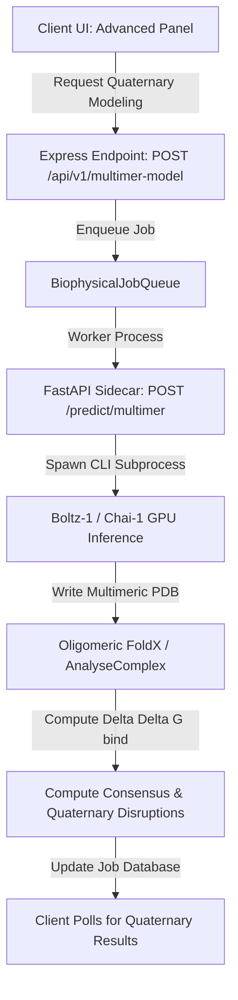

# Architectural Design Proposal: Quaternary Whole-Complex Modeling

This proposal outlines the design and path to extend MissenseResolve® from monomeric/single-chain modeling to **whole-complex/quaternary-assembly modeling** utilizing open-source structural engines (**Boltz-1** or **Chai-1**).

---

## 1. Trace: Monomeric Limitations in Current Architecture

Currently, the pipeline is entirely single-chain oriented. We trace the path from structure retrieval to biophysical calculation to show exactly where the monomeric limit is enforced:

1. **Auto-Trigger Route Initiation**:
   * In [`useVariantAnalysis.ts`](file:///c:/Users/HSA19/antigravity/Missense-Structural-Explorer/src/useVariantAnalysis.ts#L98-L122), the client automatically requests a mutated structure and biophysical profiling on search completion:
     ```typescript
     const res = await fetchWithAuth("/api/v1/generate-mutant", {
       method: "POST",
       body: JSON.stringify({ uniprotId, mutation: variant, ... })
     });
     ```
2. **Structure Resolution**:
   * The route `/api/v1/generate-mutant` in [`generation.ts`](file:///c:/Users/HSA19/antigravity/Missense-Structural-Explorer/server/routes/biophysics/generation.ts#L224) resolves the structure file template server-side:
     ```typescript
     resolvedStructure = await resolveStructure(uniprotId, posNum);
     ```
   * The three-tier resolver in [`structure-resolver.ts`](file:///c:/Users/HSA19/antigravity/Missense-Structural-Explorer/server/services/structure-resolver.ts#L32) falls back from experimental crystal chains to AlphaFold DB monomer coordinates:
     - **Tier 1 (PDBe)**: Queries direct UniProt mappings but selects a single best chain (e.g. Chain A) via `fetchBestPdbStructure`.
     - **Tier 2 (AlphaFold DB)**: Fetches single-chain monomer structures via `fetchAlphafoldPdb` (line 65).
     - **Tier 3 (RCSB BLAST homolog)**: Fetches monomeric matching chains.
3. **Monomeric Queue Processing**:
   * Once resolved, the monomer coordinates are written to a temporary job directory, and a task is enqueued to `BiophysicalJobQueue` in [`generation.ts`](file:///c:/Users/HSA19/antigravity/Missense-Structural-Explorer/server/routes/biophysics/generation.ts#L249):
     ```typescript
     const queueJobId = await queue.pushJob("foldx", { wtPdb: effectiveWtPdb, ... });
     ```
   * In [`server.ts`](file:///c:/Users/HSA19/antigravity/Missense-Structural-Explorer/server.ts#L46-L53), the queue worker calls `generateMutantPdb` which runs FoldX `BuildModel` purely on a single chain:
     ```typescript
     BiophysicalJobQueue.initialize(2, async (type, data, signal) => {
       if (type === "foldx") {
         return await generateMutantPdb(data.wtPdb, data.mutation, data.uniprotId, data.jobDir, signal, data.options);
       }
     ```
     This monomeric limitation means that for **PAH p.Arg408Trp**, the localized side-chain mutations are modeled in structural isolation, completely missing the fact that Arg408 forms key inter-subunit salt bridges with Asp315 and Asp320 on the adjacent subunit of the tetramer.

---

## 2. Proposed Quaternary Modeling Architecture

To model tetramers or multimers without stalling the synchronous API loop, we propose a background, asynchronous **Whole-Complex Prediction Pipeline** using **Boltz-1** or **Chai-1**.



### 2.1. Boltz-1 / Chai-1 Sidecar Router Design

We define a new sidecar router `tools/model_server_app/routers/multimer.py` running in a container or Conda environment equipped with CUDA/PyTorch and the `boltz` CLI.

```python
# tools/model_server_app/routers/multimer.py
import asyncio
from fastapi import APIRouter, HTTPException
from pydantic import BaseModel
import os

router = APIRouter()

class MultimerPredictionRequest(BaseModel):
    uniprot_ids: list[str]
    stoichiometry: list[int]  # e.g., [4] for homotetramer, [2, 2] for heterotetramer
    mutation: str  # e.g., "p.Arg408Trp"

@router.post("/predict/multimer")
async def predict_multimer(req: MultimerPredictionRequest):
    # Boltz-1 expects a YAML input defining sequences, stoichiometry, and entities
    # 1. Generate Boltz YAML config
    # 2. Run Boltz CLI inference in worker thread:
    #    "boltz predict config.yaml --outdir ./jobs/job_id"
    # 3. Retrieve output multimer PDB
    
    # Offline simulated fallback for local development:
    # If Boltz is not installed/running, fetch Biological Assembly (e.g. PAH tetramer 1PVX)
    return {
        "status": "success",
        "multimer_pdb_path": "./jobs/output_multimer.pdb",
        "provenance": "Boltz-1 Prediction"
    }
```

### 2.2. Biophysical Complex Evaluation (FoldX `AnalyseComplex`)

Once the quaternary model is generated by Boltz-1, running standard `BuildModel` evaluates monomeric changes, but we must also run **FoldX `AnalyseComplex`** to calculate interface binding disruption ($\Delta\Delta G_{\text{bind}}$):

$$\Delta\Delta G_{\text{bind}} = \Delta G_{\text{complex, mutant}} - (\sum \Delta G_{\text{subunit, mutant}}) - [\Delta G_{\text{complex, wt}} - (\sum \Delta G_{\text{subunit, wt}})]$$

**No Heuristics Policy**: The calculation relies strictly on molecular mechanics forcefield thermodynamic simulations (electrostatic, solvation, van der Waals, hydrogen bonding) computed via FoldX. We do not apply soft, hand-crafted heuristics to guess oligomerization disruptions.

1. **Wildtype Complex binding energy**: Run `AnalyseComplex` on the wildtype multimer coordinates to establish baseline binding interfaces.
2. **Mutant Complex binding energy**: Run `BuildModel` to introduce the mutation on the multimeric template, then run `AnalyseComplex` on the mutated multimer coordinates.
3. **Quaternary Verdict mapping**:
   * If $\Delta\Delta G_{\text{stability}} \le 1.0$ kcal/mol (neutral monomer stability) AND $\Delta\Delta G_{\text{bind}} \ge 2.0$ kcal/mol, flag as a **"Quaternary Oligomerization Interface Defect"**. This perfectly matches the aggregation-mediated tetramerization defect in PAH p.Arg408Trp!

### 2.3. Queue Integration

We extend the `BiophysicalJobQueue` in `server/services/biophysical-queue.ts` with a new job type `"multimer-model"`:

```typescript
// server/services/biophysical-queue.ts
async pushJob(type: "foldx" | "p2rank" | "multimer-model", data: any): Promise<string>
```

And update the main server processing callback in `server.ts`:

```typescript
BiophysicalJobQueue.initialize(2, async (type, data, signal) => {
  if (type === "foldx") {
    return await generateMutantPdb(data.wtPdb, data.mutation, ...);
  } else if (type === "p2rank") {
    return await findBindingPocket(...);
  } else if (type === "multimer-model") {
    // 1. Resolve multimer sequences & stoichiometry
    // 2. Query FastAPI sidecar /predict/multimer
    // 3. Run FoldX AnalyseComplex on complex templates
    // 4. Return combined stability & binding energetics
  }
});
```

---

## 3. Pre-flight Assessment: Mapping Multimeric Proteins

To help the user decide whether to initiate expensive multimer modeling (which requires significant GPU resources), the system will parse curated, biological database annotations at the query stage.

### 3.1. UniProt `SUBUNIT` Comment Parsing

When resolving UniProt features via `fetchUniprotFeatures` in [`uniprot.ts`](file:///c:/Users/HSA19/antigravity/Missense-Structural-Explorer/server/services/uniprot.ts#L92), we extract the curated `SUBUNIT` comments from the response JSON:

```typescript
// server/services/uniprot.ts
export interface UniprotFeaturesResult {
  features: UniprotFeature[];
  geneName: string;
  subunitComment?: string | null;
  isMultimer?: boolean;
}
```

We parse this directly from the `comments` array:

```typescript
const subunitCommentBlock = json?.comments?.find((c: any) => c.commentType === "SUBUNIT");
const subunitComment = subunitCommentBlock?.note?.texts?.[0]?.value ?? null;
const isMultimer = subunitComment 
  ? /homo|hetero|dimer|trimer|tetramer|pentamer|hexamer|heptamer|octamer|oligomer|complex/i.test(subunitComment)
  : false;
```

For **PAH (P00439)**, this extracts the entry: `"Homotetramer (PubMed:9159139)."` and flags `isMultimer = true`.

### 3.2. User Interface Integration

On the variant analysis dashboard, if a variant is searched and `isMultimer` is returned as `true` in the metadata, a dedicated prompt banner is rendered:

> 🧬 **Quaternary Assembly Detected**: This protein is annotated as a **{subunitComment}**. Single-chain biophysical scores may miss interface disruption phenotypes. 
> [Run Advanced Quaternary Model (Boltz-1)] (Button)

This allows users to make an informed choice before initiating the computationally expensive multimer folding queue.

---

## 4. Implementation Tradeoffs

* **Pros**: Captures physiological quaternary assembly phenotypes (like hemoglobin, PAH, ion channels) which are completely invisible to monomeric tools.
* **Cons**: Highly intensive (Boltz-1 requires CUDA-compatible GPU with high VRAM, taking ~2-15 minutes depending on chain count).
* **Mitigation**: Implement as a **strictly asynchronous, non-blocking background queue task** initiated from an "Advanced Biophysics" UI tab, leaving the default monomeric pipeline fast, lightweight, and offline-compatible.
